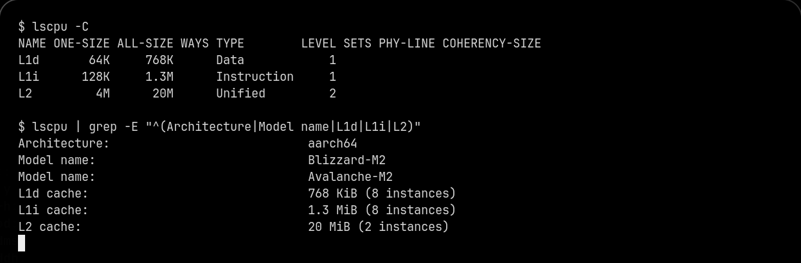
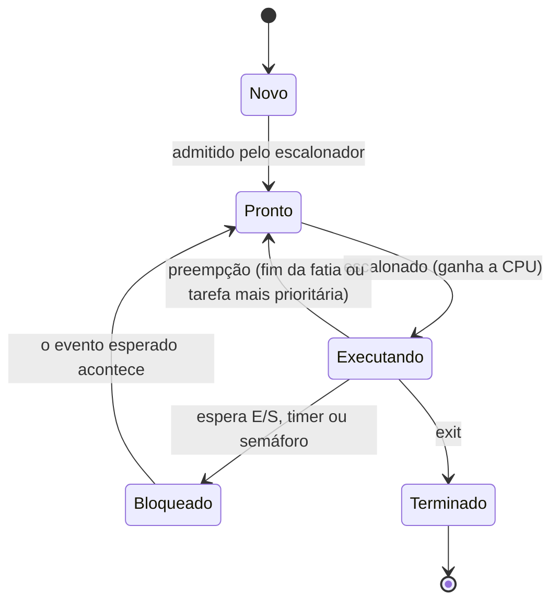
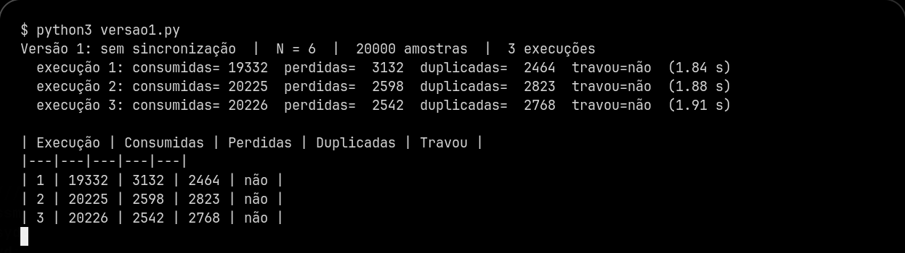
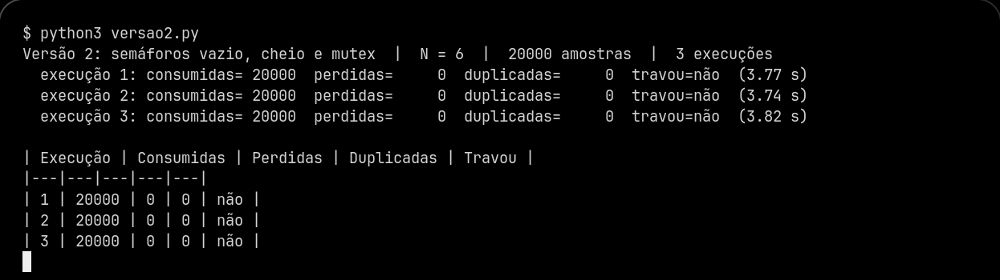
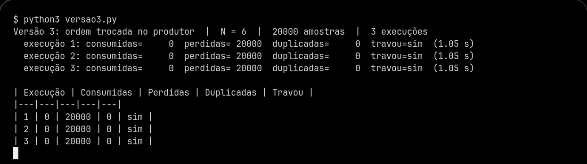
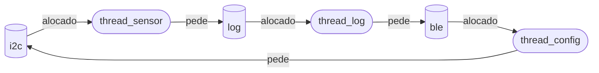

**Bruno Discacciati Vieiralves Martins** · D1 = 5 · D2 = 3 · N = 6

# Ponderada CC08: do pipeline ao deadlock

## Parâmetros individuais

&emsp;O primeiro nome, Bruno, tem 5 letras, então D1 = 5. O nome completo soma Bruno (5) + Discacciati (11) + Vieiralves (10) + Martins (7) = 33 letras, e o último dígito dá D2 = 3.

<p align="center"><b>Tabela 0</b> Parâmetros calculados a partir do nome</p>

| Parâmetro | Fórmula | Conta | Valor |
|---|---|---|---|
| IC (instruções por amostra) | 100.000 + 20.000 × D2 | 100.000 + 20.000 × 3 | 160.000 |
| m (falta na L1 do SoC) | 3% + 0,5% × D1 | 3% + 0,5% × 5 | 5,5% |
| N (posições do buffer) | 3 + (D2 mod 5) | 3 + (3 mod 5) | 6 |

# Parte A: o problema técnico

## A1. Arquitetura e memória: qual processador vai na pulseira?

### Plataforma H

&emsp;O tempo de CPU é o número de ciclos dividido pela frequência, e o número de ciclos é IC × CPI:

```
ciclos  = IC × CPI = 160.000 × 1,5 = 240.000 ciclos
tempo_H = 240.000 / 48.000.000 Hz = 0,005 s = 5,000 ms
```

&emsp;A Plataforma H atende o requisito, mas no limite exato: 5,000 ms contra um máximo de 5 ms, com margem zero. Como ela não tem cache nem sistema operacional, esse número é também o pior caso (a SRAM responde sempre em 1 ciclo), e isso é bom. O problema é que qualquer instrução a mais no código, uma interrupção do Bluetooth ou uma correção de bug que aumente o filtro já estoura o prazo.

### Plataforma V

&emsp;O tempo médio de acesso à memória soma o tempo de acerto com a fração de faltas vezes a penalidade:

```
AMAT = acerto + m × penalidade = 1 + 0,055 × 120 = 1 + 6,6 = 7,6 ciclos
```

&emsp;O CPI efetivo soma ao CPI ideal as paradas causadas pelas faltas, que dependem de quantas vezes cada instrução vai à memória:

```
paradas por instrução = 1,3 × 0,055 × 120 = 8,58 ciclos
CPI efetivo           = 1,0 + 8,58 = 9,58
ciclos                = 160.000 × 9,58 = 1.532.800 ciclos
tempo_V (médio)       = 1.532.800 / 1.200.000.000 Hz = 1,277 ms
tempo_V (pior caso)   = 1,277 ms + 3 ms do Linux = 4,277 ms
```

&emsp;A Plataforma V atende os 5 ms no pior caso, com 0,72 ms de folga. Chama atenção que 8,58 dos 9,58 ciclos por instrução (cerca de 90%) são espera pela memória: o processador é 25 vezes mais rápido que o H no clock, mas passa quase todo o tempo parado. E esse pior caso só vale enquanto o Linux cumprir a promessa de nunca segurar a tarefa por mais de 3 ms, e num Linux comum isso é uma estimativa sem garantia formal.

### Acelerador DSP na Plataforma H (Lei de Amdahl)

&emsp;Só a parte acelerada (o filtro, 60% do tempo) fica 5 vezes mais rápida; os outros 40% continuam iguais:

```
speedup  = 1 / ((1 − 0,6) + 0,6 / 5) = 1 / (0,4 + 0,12) = 1 / 0,52 ≈ 1,923
tempo_H' = 5,000 ms / 1,923 = 5,000 × 0,52 = 2,600 ms
```

&emsp;Com o DSP a Plataforma H passa a atender com 2,4 ms de folga (48% do orçamento). Mesmo acelerando o filtro 5 vezes, o ganho total fica em 1,92 vezes, porque os 40% que não usam o DSP passam a dominar: esse é o limite que a Lei de Amdahl mostra.

<p align="center"><b>Tabela A1.1</b> Resumo da A1</p>

| Opção | Tempo por amostra | Pior caso | Atende 5 ms? | Folga |
|---|---|---|---|---|
| Plataforma H | 5,000 ms | 5,000 ms | sim, no limite | 0 ms |
| Plataforma V | 1,277 ms | 4,277 ms | sim | 0,72 ms |
| Plataforma H + DSP | 2,600 ms | 2,600 ms | sim | 2,40 ms |

### Por que a V precisa de cache e a H não

&emsp;Na Von Neumann, instruções e dados disputam o mesmo caminho até a mesma memória, e esse caminho é o gargalo.
Na V cada instrução faz 1,3 acessos a uma DRAM de 120 ciclos: sem cache, o CPI seria 1 + 1,3 × 120 = 157.
Isso daria 160.000 × 157 / 1,2 GHz ≈ 20,9 ms por amostra, quatro vezes o limite; a cache esconde essa distância.
A H é Harvard, com caminhos separados para instrução e dado, e a SRAM responde em 1 ciclo a 48 MHz.
Lá a memória acompanha o processador, então não há distância para esconder.

### Evidência da minha máquina

<p align="center"><b>Figura A1.1</b> Caches do meu computador (Apple M2 rodando Linux, saída do lscpu)</p>



&emsp;A L1 é dividida: cada núcleo tem uma L1 de dados (L1d, 64 KiB nos núcleos mostrados) e uma L1 de instruções (L1i, 128 KiB), enquanto a L2 já é unificada. Isso quer dizer que, perto do núcleo, o meu computador funciona como Harvard: ele busca a próxima instrução e lê um dado no mesmo ciclo, por caminhos separados. Mas a L2 e a memória principal são uma só, com um único espaço de endereçamento onde programas e dados convivem (um programa é carregado na memória como dado antes de ser executado). Então o meu computador é Von Neumann na organização do sistema, com um núcleo de Harvard modificada nas caches L1, que é o arranjo usado hoje por praticamente todo processador de uso geral para aliviar o gargalo de Von Neumann sem abrir mão de uma memória única.

## A2. Pipeline: o loop do filtro

### Dependências de dados (RAW)

&emsp;Uma dependência RAW (leitura depois de escrita) acontece quando uma instrução lê um registrador que uma instrução anterior ainda vai escrever. No trecho, as instruções 6 e 7 só mexem em `x10` e `x11` depois que os `lw` já leram esses registradores, então elas criam dependências WAR, que não causam bolha num pipeline em ordem. As dependências RAW são quatro:

<p align="center"><b>Tabela A2.1</b> Dependências RAW do trecho</p>

| Instrução que depende | Depende de | Registrador | Tipo |
|---|---|---|---|
| 2 `add x6, x6, x5` | 1 `lw x5, 0(x10)` | x5 | carga seguida de uso |
| 4 `sub x6, x6, x7` | 3 `lw x7, 0(x11)` | x7 | carga seguida de uso |
| 4 `sub x6, x6, x7` | 2 `add x6, x6, x5` | x6 | ULA seguida de ULA |
| 5 `sw x6, 0(x12)` | 4 `sub x6, x6, x7` | x6 | ULA seguida de store |

### Sem forwarding

&emsp;Sem forwarding, a instrução dependente só pode ler o registrador no estágio ID depois que a produtora passou pelo WB. Como o banco é escrito na primeira metade do ciclo e lido na segunda, o ID da dependente pode cair no mesmo ciclo do WB da produtora. Uma produtora que entra em IF no ciclo c faz WB no ciclo c+4, e a dependente que vem logo depois faria ID no ciclo c+2, então cada dependência entre instruções vizinhas custa duas bolhas. Na tabela, "st" é um ciclo parado (bolha) e a instrução seguinte fica presa no IF enquanto isso.

<p align="center"><b>Tabela A2.2</b> Diagrama do pipeline sem forwarding</p>

| Instrução | 1 | 2 | 3 | 4 | 5 | 6 | 7 | 8 | 9 | 10 | 11 | 12 | 13 | 14 | 15 | 16 | 17 |
|---|---|---|---|---|---|---|---|---|---|---|---|---|---|---|---|---|---|
| 1 lw x5 | IF | ID | EX | MEM | WB | | | | | | | | | | | | |
| 2 add x6 | | IF | st | st | ID | EX | MEM | WB | | | | | | | | | |
| 3 lw x7 | | | IF | st | st | ID | EX | MEM | WB | | | | | | | | |
| 4 sub x6 | | | | | | IF | st | st | ID | EX | MEM | WB | | | | | |
| 5 sw x6 | | | | | | | IF | st | st | st | st | ID | EX | MEM | WB | | |
| 6 addi x10 | | | | | | | | | | | | IF | ID | EX | MEM | WB | |
| 7 addi x11 | | | | | | | | | | | | | IF | ID | EX | MEM | WB |

&emsp;A instrução 5 fica presa no IF do ciclo 7 ao 11, primeiro porque a 4 ainda está parada no ID e depois esperando o próprio dado, então a instrução 6 só é buscada no ciclo 12 e a 7 no ciclo 13. Nenhuma das duas depende de algo pendente, então daí em diante o pipeline anda sem parar. A conta fecha assim: sem nenhuma bolha, 7 instruções levariam 5 + (7 − 1) = 11 ciclos. A instrução 2 espera o WB da 1 (ciclo 5), o que custa 2 bolhas. A instrução 4 espera o WB da 3 (ciclo 9), mais 2. A instrução 5 espera o WB da 4 (ciclo 12), mais 2. São 11 + 6 = **17 ciclos** do primeiro IF ao último WB.

### Com forwarding

&emsp;Com forwarding, o resultado de uma instrução de ULA sai do estágio EX e vai direto para o EX da instrução seguinte, sem bolha. O `sw` também recebe o `x6` por forwarding, porque o dado só é usado no estágio MEM. O caso que sobra é o `lw`: o valor lido da memória só existe no fim do estágio MEM, e a instrução logo depois já precisaria dele no começo do seu EX, que acontece no mesmo ciclo. Não há como mandar um dado para trás no tempo, então cada carga seguida de uso custa uma bolha mesmo com forwarding.

<p align="center"><b>Tabela A2.3</b> Diagrama do pipeline com forwarding</p>

| Instrução | 1 | 2 | 3 | 4 | 5 | 6 | 7 | 8 | 9 | 10 | 11 | 12 | 13 |
|---|---|---|---|---|---|---|---|---|---|---|---|---|---|
| 1 lw x5 | IF | ID | EX | MEM | WB | | | | | | | | |
| 2 add x6 | | IF | ID | st | EX | MEM | WB | | | | | | |
| 3 lw x7 | | | IF | st | ID | EX | MEM | WB | | | | | |
| 4 sub x6 | | | | | IF | ID | st | EX | MEM | WB | | | |
| 5 sw x6 | | | | | | IF | st | ID | EX | MEM | WB | | |
| 6 addi x10 | | | | | | | | IF | ID | EX | MEM | WB | |
| 7 addi x11 | | | | | | | | | IF | ID | EX | MEM | WB |

&emsp;O total é 11 + 2 = **13 ciclos**. As duas bolhas que sobram são as cargas seguidas de uso: a instrução 2 usa o `x5` que a instrução 1 acabou de carregar, e a instrução 4 usa o `x7` que a instrução 3 acabou de carregar. As dependências de `x6` entre `add`, `sub` e `sw` deixam de custar ciclos.

### Reordenação

&emsp;Para tirar as duas bolhas basta que nenhuma instrução use o valor de um `lw` no ciclo logo seguinte. Trocando a instrução 2 com a 3, as duas cargas vêm primeiro e cada uso fica a duas instruções da sua carga, distância que o forwarding cobre. O resultado não muda: `add` e `sub` continuam na mesma ordem entre si, o `sw` continua depois do `sub`, e os `addi` continuam depois dos `lw` que leem `x10` e `x11`.

<p align="center"><b>Tabela A2.4</b> Nova ordem e diagrama com forwarding</p>

| Instrução | 1 | 2 | 3 | 4 | 5 | 6 | 7 | 8 | 9 | 10 | 11 |
|---|---|---|---|---|---|---|---|---|---|---|---|
| 1 `lw x5, 0(x10)` | IF | ID | EX | MEM | WB | | | | | | |
| 3 `lw x7, 0(x11)` | | IF | ID | EX | MEM | WB | | | | | |
| 2 `add x6, x6, x5` | | | IF | ID | EX | MEM | WB | | | | |
| 4 `sub x6, x6, x7` | | | | IF | ID | EX | MEM | WB | | | |
| 5 `sw x6, 0(x12)` | | | | | IF | ID | EX | MEM | WB | | |
| 6 `addi x10, x10, 4` | | | | | | IF | ID | EX | MEM | WB | |
| 7 `addi x11, x11, 4` | | | | | | | IF | ID | EX | MEM | WB |

&emsp;O `add` faz EX no ciclo 5, logo depois do MEM do primeiro `lw` (ciclo 4), e o `sub` faz EX no ciclo 6, logo depois do MEM do segundo `lw` (ciclo 5). Os dois recebem o dado por forwarding do estágio MEM/WB, sem esperar. O trecho passa a levar **11 ciclos**, o mínimo possível para 7 instruções num pipeline de 5 estágios.

## A3. Processos e threads: como organizar o software

### Organização proposta

&emsp;A proposta é dividir o software em dois processos. O primeiro é o processo de segurança, com três threads: leitura do sensor, processamento da amostra e acionamento do motor. O segundo é o processo de comunicação, que fala com o celular por BLE. Os dois conversam por um canal de comunicação entre processos com mensagens pequenas e sem bloqueio (por exemplo, um socket Unix ou uma fila em memória compartilhada só de leitura para o lado BLE).

<p align="center"><b>Tabela A3.1</b> Organização das quatro tarefas</p>

| Tarefa | Onde roda | Por quê |
|---|---|---|
| Ler o sensor | thread do processo de segurança | precisa entregar a amostra ao processamento sem cópia e sem atraso |
| Processar a amostra | thread do processo de segurança | lê e escreve o mesmo buffer do sensor e do motor |
| Acionar o motor | thread do processo de segurança | precisa do resultado do processamento dentro dos 5 ms |
| BLE (log e configuração) | processo separado | recebe dados de fora e não tem prazo rígido |

&emsp;O critério de compartilhamento de memória junta as três primeiras tarefas. Elas trabalham em cima das mesmas amostras a cada 10 ms, e threads de um mesmo processo enxergam o mesmo espaço de endereçamento. O buffer da A4 é só uma estrutura na memória, sem cópia entre espaços diferentes e sem chamada de sistema para cada amostra.

&emsp;O critério de custo também favorece threads no caminho crítico. Criar uma thread é mais barato que criar um processo, porque não há espaço de endereçamento novo para montar, e a troca de contexto entre threads do mesmo processo não troca a tabela de páginas nem invalida a TLB. Num orçamento de 5 ms por amostra, com até 3 ms já comprometidos pelo pior caso do Linux, cada troca de contexto mais cara pesa. As três threads são criadas uma vez, no boot, e ficam vivas, com prioridade de tempo real (SCHED_FIFO) acima de tudo o resto.

&emsp;O critério de isolamento de falhas separa o BLE. Uma thread que corrompe memória ou trava derruba o processo inteiro, porque todas as threads dividem a mesma memória e o mesmo destino. Se o BLE fosse uma thread, um erro na pilha Bluetooth poderia parar a leitura do sensor. Como processo separado, ele pode cair e ser reiniciado pelo sistema sem que a vibração pare. O preço é a latência da comunicação entre processos, e o BLE pode pagar esse preço: um log que chega ao celular alguns milissegundos depois não coloca ninguém em risco.

### O BLE recebe dados de fora

&emsp;O módulo BLE é a única porta da pulseira aberta para o mundo, e qualquer aparelho por perto pode tentar mandar um pacote malformado para ele. Se ele for uma thread do processo principal e alguém explorar uma falha (um estouro de buffer, por exemplo), o código do atacante passa a rodar dentro do mesmo espaço de memória do sensor e do motor. Ele pode ler e alterar as amostras, desligar a vibração ou mandar o motor avisar um obstáculo que não existe, e não há nada no sistema operacional que o impeça, porque para o kernel tudo aquilo é um processo só.

&emsp;Se o BLE for um processo separado, a mesma falha dá ao atacante só o que aquele processo pode fazer. O kernel não deixa um processo ler ou escrever a memória de outro, então o caminho até o motor passa a ser apenas o canal de mensagens, que aceita um conjunto pequeno e validado de comandos. Esse processo ainda pode rodar com um usuário sem privilégios e sem acesso ao I2C do sensor. A falha continua existindo, mas a consequência deixa de ser "controlar a pulseira" e passa a ser "derrubar o Bluetooth", e a pessoa continua recebendo a vibração.

### Diagrama de estados

<p align="center"><b>Figura A3.1</b> Diagrama de estados de um processo</p>



&emsp;A thread do sensor passa a maior parte do tempo no estado **Bloqueado**. Ela acorda a cada 10 ms, pede a leitura ao sensor pelo I2C (e fica bloqueada de novo enquanto a transferência acontece), põe a amostra no buffer e volta a esperar o próximo tique do timer. O trabalho dela em CPU leva uma fração pequena do período: mesmo no pior caso da Plataforma V, o processamento inteiro da amostra cabe em poucos milissegundos, e a parte do sensor é só copiar um valor. No resto dos 10 ms não há nada para ela fazer, e esperar bloqueada (em vez de girar num laço) é justamente o que libera a CPU para o processamento e o motor.

## A4. Código com semáforos: o buffer entre o sensor e o motor

&emsp;O código está em `ponderada/codigo`, em Python 3 com `threading`. Cada versão roda com um comando (`python3 versao1.py`, `python3 versao2.py`, `python3 versao3.py`) e já faz as 3 execuções de 20.000 amostras com N = 6. O módulo `comum.py` concentra o que precisa ser igual nas três versões: a regra de travamento (1 s sem receber nada), a contagem e a tabela. Uma amostra é perdida quando foi gerada e nunca chegou ao motor, e duplicada quando chegou ao motor mais de uma vez.

<p align="center"><b>Tabela A4.1</b> Resultados das 9 execuções (N = 6, 20.000 amostras)</p>

| Versão | Execução | Consumidas | Perdidas | Duplicadas | Travou |
|---|---|---|---|---|---|
| 1, sem sincronização | 1 | 19.332 | 3.132 | 2.464 | não |
| 1, sem sincronização | 2 | 20.225 | 2.598 | 2.823 | não |
| 1, sem sincronização | 3 | 20.226 | 2.542 | 2.768 | não |
| 2, semáforos | 1 | 20.000 | 0 | 0 | não |
| 2, semáforos | 2 | 20.000 | 0 | 0 | não |
| 2, semáforos | 3 | 20.000 | 0 | 0 | não |
| 3, ordem trocada | 1 | 0 | 20.000 | 0 | sim |
| 3, ordem trocada | 2 | 0 | 20.000 | 0 | sim |
| 3, ordem trocada | 3 | 0 | 20.000 | 0 | sim |

<p align="center"><b>Figura A4.1</b> Execução da versão 1</p>



<p align="center"><b>Figura A4.2</b> Execução da versão 2</p>



<p align="center"><b>Figura A4.3</b> Execução da versão 3</p>



### Região crítica da versão 1

&emsp;A região crítica é a atualização do contador `ocupadas`, junto com o acesso à posição do buffer que esse contador autoriza. No código, o incremento do produtor e o decremento do consumidor acontecem em dois passos, `valor = exp.ocupadas` e depois `exp.ocupadas = valor + 1` (ou `- 1`), com o `time.sleep(0)` no meio, que entrega a CPU para a outra thread exatamente entre ler e escrever.

&emsp;Quando as duas threads intercalam ali, uma das atualizações se perde. Por exemplo, com o contador em 3, o produtor lê 3 e é interrompido; o consumidor lê 3, retira uma amostra e escreve 2; o produtor volta e escreve 4. Agora o contador diz 4, mas só há 3 amostras novas no buffer, e o consumidor vai acabar lendo uma posição que o produtor ainda não reescreveu, entregando ao motor uma amostra antiga de novo: uma **duplicada**. A intercalação contrária deixa o contador menor do que o real, o produtor acha que tem espaço e escreve por cima de uma amostra que o motor ainda não leu: uma **perdida**. Por isso as consumidas nem chegam a 20.000 exatas (19.332 e 20.226): o contador deixou de contar a verdade. Nas três execuções não houve travamento porque o erro do contador oscila para cima e para baixo, mas nada impede que um dia ele trave as duas threads esperando uma pela outra.

### O que cada semáforo garante na versão 2

<p align="center"><b>Tabela A4.2</b> Papel de cada semáforo</p>

| Semáforo | Valor inicial | Garante |
|---|---|---|
| vazio | N = 6 | o produtor nunca escreve numa posição que o motor ainda não leu; com o buffer cheio ele dorme em vez de sobrescrever (sem perdas) |
| cheio | 0 | o consumidor nunca lê uma posição que ainda não foi escrita; com o buffer vazio ele dorme em vez de reler (sem duplicadas) e sem gastar CPU girando |
| mutex | 1 | só uma thread por vez mexe no buffer e nos índices, então a escrita e a leitura de uma posição nunca são cortadas no meio (exclusão mútua) |

&emsp;A versão 2 manteve o mesmo `time.sleep(0)` dentro da região crítica, e mesmo assim todas as 60.000 amostras das três execuções chegaram uma única vez. A interrupção no pior momento continua acontecendo, ela só deixou de causar dano. O custo apareceu no tempo: cerca de 3,8 s por execução contra 1,9 s da versão 1, porque cada amostra passa por seis operações de semáforo.

### O que aconteceu na versão 3

&emsp;As três execuções travaram, e o estado no momento do travamento confirma o motivo: `vazio = 0`, `mutex = 0`, `cheio = 5` e o buffer com as amostras 0 a 5. O produtor encheu as 6 posições, pegou o mutex para gravar a amostra 6 e só então fez wait(vazio), que bloqueou porque o buffer estava cheio. Ele dormiu segurando o mutex. O consumidor conseguiu passar por wait(cheio), mas parou em wait(mutex). O único que poderia liberar uma posição (o consumidor) precisa do mutex, e o único que tem o mutex (o produtor) espera uma posição livre: é um deadlock com as quatro condições presentes, exclusão mútua no mutex, posse e espera, nenhuma forma de tirar o mutex do produtor e espera circular entre os dois.

&emsp;O travamento aconteceu sem nenhuma amostra consumida porque o semáforo do Python não é justo: quando o produtor solta o mutex, ele mesmo pega de novo antes do consumidor acordar, então enche o buffer de uma vez. Com um escalonador mais justo, algumas amostras passariam antes, mas o resultado seria o mesmo: assim que o buffer encher com o produtor segurando o mutex, a pulseira trava. A regra que a versão 2 segue, e que resolve, é esperar pelo recurso contado (vazio ou cheio) antes de pegar o mutex.

## A5. Deadlock: a pulseira congelou

### Sequência que leva ao deadlock

&emsp;Cada thread pega um recurso e, antes de devolvê-lo, pede o recurso que a próxima thread já pegou. Basta que as três executem a primeira linha antes de qualquer uma chegar na segunda aquisição:

<p align="center"><b>Tabela A5.1</b> Intercalação que leva ao deadlock</p>

| Passo | Thread | Operação | Resultado |
|---|---|---|---|
| 1 | thread_sensor | P(i2c) | consegue; segura o I2C |
| 2 | thread_log | P(log) | consegue; segura o log |
| 3 | thread_config | P(ble) | consegue; segura o BLE |
| 4 | thread_sensor | le_sensor(), depois P(log) | bloqueia: o log está com thread_log |
| 5 | thread_log | le_log(), depois P(ble) | bloqueia: o BLE está com thread_config |
| 6 | thread_config | recebe_comando(), depois P(i2c) | bloqueia: o I2C está com thread_sensor |

&emsp;Depois do passo 6, nenhuma das três consegue avançar até a sua V(), então nenhum recurso é devolvido e o sistema fica parado para sempre. Na pulseira isso aparece como congelamento: a thread do sensor não lê mais, o motor não recebe amostras e a pessoa deixa de receber vibração até desligar e ligar.

<p align="center"><b>Figura A5.1</b> Grafo de alocação de recursos depois do passo 6</p>



&emsp;Uma seta do recurso para a thread indica que ela segura o recurso, e uma seta da thread para o recurso indica que ela está esperando por ele. O grafo tem um ciclo, i2c → sensor → log → thread_log → ble → config → i2c, e como cada recurso tem uma única instância (semáforo binário), ciclo no grafo significa deadlock.

### As quatro condições no código

<p align="center"><b>Tabela A5.2</b> Condições de Coffman no código da pulseira</p>

| Condição | Onde aparece |
|---|---|
| Exclusão mútua | i2c, log e ble são semáforos binários: só uma thread usa cada recurso por vez. |
| Posse e espera | cada thread faz o segundo P() ainda segurando o primeiro recurso (o sensor pede o log com o I2C na mão, por exemplo). |
| Sem preempção | P() bloqueia sem prazo e nada tira um recurso de quem o segura; só a própria thread faz V(). |
| Espera circular | sensor espera log, log espera ble, config espera i2c, e o i2c está com o sensor: as três ordens de aquisição formam um ciclo. |

### Duas correções

&emsp;A primeira correção é de prevenção, quebrando a espera circular com uma ordem global de aquisição. Todo código passa a pegar os recursos sempre na mesma ordem, por exemplo i2c antes de log antes de ble. A thread_sensor e a thread_log já seguem essa ordem. A thread_config é reescrita para receber o comando segurando só o BLE, soltar o BLE e só então fazer P(i2c) para ajustar o sensor, ou, se precisar dos dois juntos, fazer P(i2c) antes de P(ble). Com uma ordem única nenhum ciclo pode se formar e o deadlock deixa de ser possível. Para quem usa a pulseira, nada muda no dia a dia: o ajuste de configuração vindo do celular pode demorar alguns milissegundos a mais, sem efeito perceptível.

&emsp;A segunda correção é de detecção e recuperação. Cada P() ganha prazo (sem_timedwait com, por exemplo, 50 ms) e um watchdog de hardware passa a reiniciar a pulseira se a thread do sensor ficar mais de um tempo limite sem entregar amostra. Se uma espera estoura o prazo, a thread devolve o que segura, espera um tempo aleatório e tenta de novo, o que desfaz o ciclo na maioria dos casos. Se mesmo assim o sensor parar, o watchdog reinicia o sistema. Para quem usa a pulseira, a recuperação por prazo é imperceptível, mas o reinício pelo watchdog significa alguns segundos sem vibração, por isso ele precisa vir com um aviso claro (um pulso longo) para a pessoa saber que deve parar até a pulseira voltar. Essa correção não elimina a causa, só limita o estrago, e ela continua valendo como rede de segurança mesmo depois da primeira estar no código.

# Parte B: a decisão do CTO

**Dilema escolhido: 2, qual processador vai para a produção.**

**Memorando ao conselho da Tato**
**De:** Bruno Discacciati Vieiralves Martins, CTO
**Assunto:** processador da pulseira de produção

&emsp;A pulseira de produção vai sair com a Plataforma H e o acelerador DSP, a R$ 37 por unidade, e não com a Plataforma V.

&emsp;O número que decidiu foi a folga de tempo. Sem o DSP, a H processa uma amostra em exatamente 5,000 ms, no limite do requisito, e por isso ela só entra com o DSP, que leva o tempo para 2,6 ms. A V fica em 4,28 ms no pior caso, mas esse pior caso depende de o Linux nunca segurar a tarefa por mais de 3 ms e da taxa de falta da cache ficar em 5,5%, e cerca de 90% dos ciclos dela já são espera pela memória. Na H com DSP, o tempo calculado é o tempo real em toda amostra: não tem cache para errar nem sistema operacional para interromper. A margem é de 2,4 ms contra 0,72 ms, e numa pulseira que avisa uma pessoa cega de um poste eu prefiro a margem que não depende de promessa.

&emsp;Do que abrimos mão: da atualização pela internet. Toda correção de firmware passa a exigir que a pessoa leve a pulseira à assistência técnica. Um bug como o deadlock da A5, que hoje corrigiríamos para todo mundo numa noite, vai levar semanas para chegar a todos, e quem paga esse custo é o usuário, com deslocamento e dias sem a pulseira, e a empresa, com a logística. Abrimos mão também do ecossistema do Linux, o que deixa o desenvolvimento de recursos novos mais lento. Em troca, economizamos R$ 33 por unidade, R$ 66 mil nas 2.000 primeiras, e ganhamos um consumo de energia bem menor, porque um microcontrolador de 48 MHz gasta muito menos bateria que um SoC de 1,2 GHz com Linux.

&emsp;Para quem usa, a resposta da vibração fica constante, sem atrasos ocasionais. O risco de segurança fica concentrado no BLE, a única porta para fora: a superfície de ataque é muito menor que a de um Linux, mas uma falha descoberta no BLE não pode ser corrigida à distância. Para reduzir esse risco, o protocolo BLE da pulseira vai aceitar só um conjunto pequeno de comandos assinados, e o firmware vai poder desligar a configuração remota sem afetar a vibração.

&emsp;O que me faria mudar de ideia: se o primeiro lote de 2.000 pulseiras exigir, no primeiro ano, mais de uma atualização corretiva por unidade, ou se o custo de cada atualização presencial passar de R$ 33 por pulseira (a diferença de preço entre as plataformas), a Plataforma V passa a sair mais barata no total, e a próxima geração migra para ela, com um Linux de tempo real medido em bancada antes de entrar em campo.
